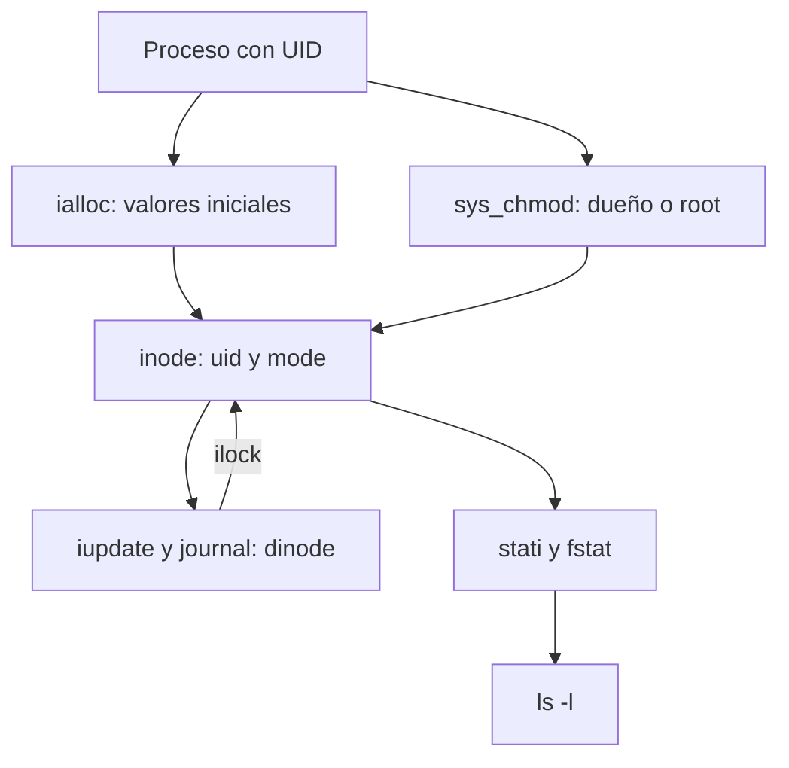

# Módulo de propietarios y permisos

Responsable: Samir Bryan Cordero Garcia (`sam-dx`). Rama: `feature/permisos-archivos`.
Base de integración: `e98304b`, rama de identidad de Isaac. Base de xv6 en main: `418f9e6`.

## Estado comprobado

| Componente o caso | Resultado |
| --- | --- |
| Inodos, mkfs, stat, chmod, ls -l | Implementados y compilados |
| P3 propietario | Aprobada en QEMU con UID 1002 controlado externamente |
| P5 dueño / ajeno / root y cinco entradas inválidas | Aprobada en QEMU |
| P7 eliminación por el dueño | Aprobada |
| P7 eliminación por otro UID | Fallida: depende de autorización de Hans |
| P8b persistencia | Aprobada al reiniciar la misma imagen |
| uidtest de Isaac | Reproducida con UID -1 esperado por su prueba actual |
| usertests -q | ALL TESTS PASSED |
| Login y auditoría | Pendientes de los módulos de Isaac y Hans |
| Publicación en GitHub | Bloqueada: integración devuelve 403 y CLI sin credenciales |

Las pruebas no equivalen a una sesión autenticada. El host cambia el UID de la
shell mediante la interfaz GDB de QEMU, enlazada solo a 127.0.0.1. No se agregó
una syscall setuid ni un mecanismo de prueba al kernel de producción.

## Diseño



| Representación | Campos | Condición |
| --- | --- | --- |
| struct proc | int uid, existente en rama de Isaac | init UID 0; fork hereda |
| struct inode | short uid, short mode | Acceso con sleeplock del inodo |
| struct dinode | short uid, short mode y 15 uint reservados | 128 bytes, 8 por bloque |
| struct stat | short uid, short mode | Permite consultar propiedad y modo |

El inodo original tiene 64 bytes. Añadir cuatro produciría 68, que no divide
1024 y rompe la aserción de mkfs. Se conservó NDIRECT=12 y el límite original
MAXFILE, ampliando el inodo a 128 bytes. NINODES sigue en 200; los bloques de
inodos pasan a 26. FSMAGIC pasa de 0x10203040 a 0x10203041: las imágenes del
formato anterior se rechazan. No existe migración de imágenes antiguas.

`ialloc` toma el UID del proceso y asigna 0644 a archivos/dispositivos y 0755
a directorios; rechaza UID negativo o fuera del rango de short positivo.
`ilock`, `iupdate` y `stati` cargan, persisten y exponen ambos campos.
`mkfs` inicializa / y /home con UID 0 y 0755; los hogares isaac y samir con
UID 1001/1002 y 0700; los programas `user/_*` con 0755 y README con 0644.

## Convención de modos

El contrato pide dígito central cero pero también usa 0644, 0755 y 0777. Para
mantener los ejemplos y seis bits efectivos, se acepta dígito central cero
o igual al de otros. Nunca se usa para autorizar; no existen grupos.
Se aceptan 0600, 0604, 0644, 0700, 0705, 0755 y 0777; se rechazan 0670,
valores negativos y bits fuera de 0777. Hans debe seleccionar exclusivamente
`(mode >> 6) & 7` para el dueño y `mode & 7` para otros; root supera los
controles ordinarios según el contrato. La convención queda documentada para
su revisión durante la integración.

## chmod y consulta

`SYS_getuid=23` pertenece a Isaac; `SYS_chmod=24` se añade en esta rama.
`chmod(const char *path, int mode)` retorna 0/-1. La syscall valida entrada,
inicia transacción, obtiene el inodo, lo bloquea, comprueba UID dueño/root,
actualiza mode y persiste con iupdate. Todo rechazo libera referencias,
cerrojos y transacción; no modifica el modo ni el propietario.

El comando acepta `chmod 600 ruta` y `chmod 0600 ruta`; exige exactamente
tres dígitos octales o cuatro con cero inicial. `ls` conserva su salida
original; `ls -l ruta` muestra seis bits rwx, UID, octal, inodo y tamaño.

## Reproducir

En Ubuntu/Debian con GCC RISC-V, binutils, QEMU >=7.2, Make, GCC del host,
Perl, Python 3 y bc:

```sh
# Solo para generar una imagen nueva del formato modificado:
make clean
make -j4 kernel/kernel fs.img
python3 tests/test_mkfs.py
python3 tests/run_samir.py
# Uso interactivo posterior, conservando la imagen:
make qemu
```

`run_samir.py` modifica la imagen de prueba y guarda resultados en
`evidencias/samir/`. Usa un reinicio real y sync, sin ejecutar mkfs entre
ambos arranques. Su código de salida refleja las comprobaciones del módulo;
P7 negativa se informa expresamente como fallida y bloqueada por integración,
sin convertirla en aprobada. Para una demostración manual con capturas:
`python3 tests/visual_samir.py` (copia la imagen a /tmp antes de probar).

Entorno verificado: Debian 13, GCC RISC-V 14.2.0, QEMU 10.0.13, un hart para
el control determinista del depurador. La compilación original admite SMP;
no se afirma haber completado pruebas de estrés concurrente multiusuario.

## Evidencias y límites

Los TXT son la salida real de QEMU, los PNG son capturas de una terminal
que ejecuta el mismo programa y los JSON contienen resultados por etapa.
`ejecucion_inicial/` conserva el fallo del uidtest original al esperar -1
cuando init ya arranca en UID 0. Se repitió con la precondición UID -1 y
pasó sin modificar el programa de Isaac. Falta adaptar su prueba a login.

P7 negativa falla porque esta rama no modifica `namex`, `open`, `exec`,
`link` ni `unlink` para aplicar la autorización de Hans. Esas funciones no
se declaran protegidas. Las capacidades de descriptores abiertos y la
auditoría deben comprobarse cuando se integre ese módulo. No fusionar en
main como sistema multiusuario terminado.

El informe compartido se mantiene en Word y no se incluye en Git, de acuerdo
con el contrato técnico. Este archivo documenta únicamente el código.

## Referencias

Cox, R., Kaashoek, F., & Morris, R. (2022). *xv6: A simple, Unix-like teaching
operating system* (Rev. 3). Massachusetts Institute of Technology.
https://pdos.csail.mit.edu/6.S081/2022/xv6/book-riscv-rev3.pdf

MIT PDOS. (s. f.). *xv6-riscv* [Código fuente]. GitHub.
https://github.com/mit-pdos/xv6-riscv
